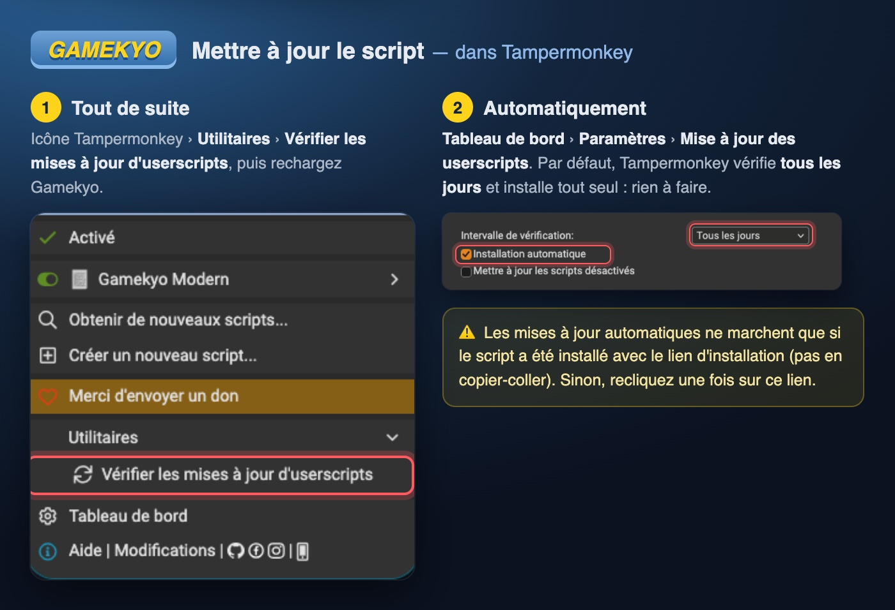

# tampermonkey-scripts

Collection de scripts utilisateur (« userscripts ») pour [Tampermonkey](https://www.tampermonkey.net/), qui modifient des sites web directement dans le navigateur.

| Script | Site | Rôle | Documentation |
| --- | --- | --- | --- |
| **Gamekyo Modern** | gamekyo.com | Refonte moderne du site, mode sombre, responsive, réglages | [README](gamekyo/README.md) · [Changelog](gamekyo/CHANGELOG.md) · [Installer](https://raw.githubusercontent.com/maximehuran/tampermonkey-scripts/main/gamekyo/gamekyo-modern.user.js) |
| **Twitch Ad Auto-Mute** | twitch.tv | Coupe le son pendant les pubs et le remet ensuite | [README](twitch/README.md) · [Installer](https://raw.githubusercontent.com/maximehuran/tampermonkey-scripts/main/twitch/twitch-ad-mute.user.js) |

## Installation

1. Installer l'extension Tampermonkey :
   - **Firefox** (ordinateur et Android) : [addons.mozilla.org](https://addons.mozilla.org/fr/firefox/addon/tampermonkey/) ;
   - **Chrome, Edge, Safari, Opera** : [tampermonkey.net](https://www.tampermonkey.net/).
2. Sur Chrome et Edge uniquement : dans `chrome://extensions` (ou `edge://extensions`), activer le **Mode développeur**, et **Autoriser les scripts utilisateur** dans les détails de Tampermonkey.
3. Cliquer sur le lien **Installer** du script voulu dans le tableau ci-dessus : Tampermonkey ouvre une page de confirmation, cliquer sur **Installer**.

## Mises à jour

Chaque script déclare `@updateURL` / `@downloadURL` pointant vers ce dépôt. S'il a été installé via son lien « Installer », Tampermonkey le met à jour tout seul (par défaut une vérification par jour, réglable dans *Tableau de bord → Paramètres → Mise à jour des userscripts*).

Pour forcer la vérification : icône Tampermonkey → **Utilitaires** → **Vérifier les mises à jour d'userscripts**.

Une mise à jour n'est proposée que si le numéro `@version` augmente : il faut l'incrémenter à chaque modification. Les versions de Gamekyo Modern sont publiées dans les [Releases](https://github.com/maximehuran/tampermonkey-scripts/releases).
