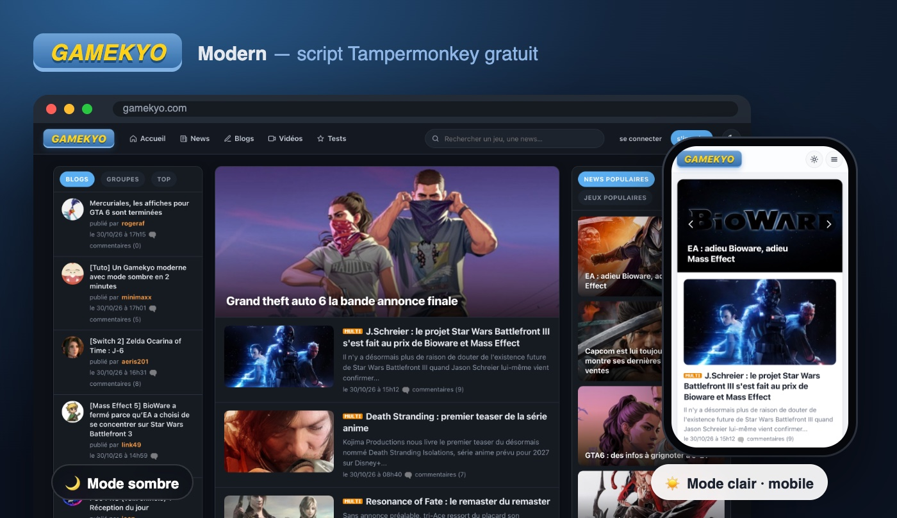
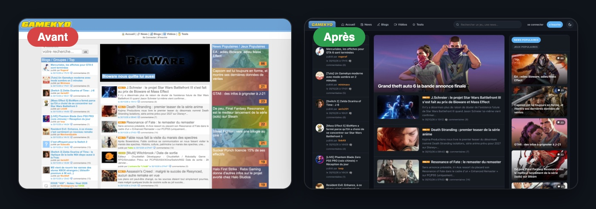
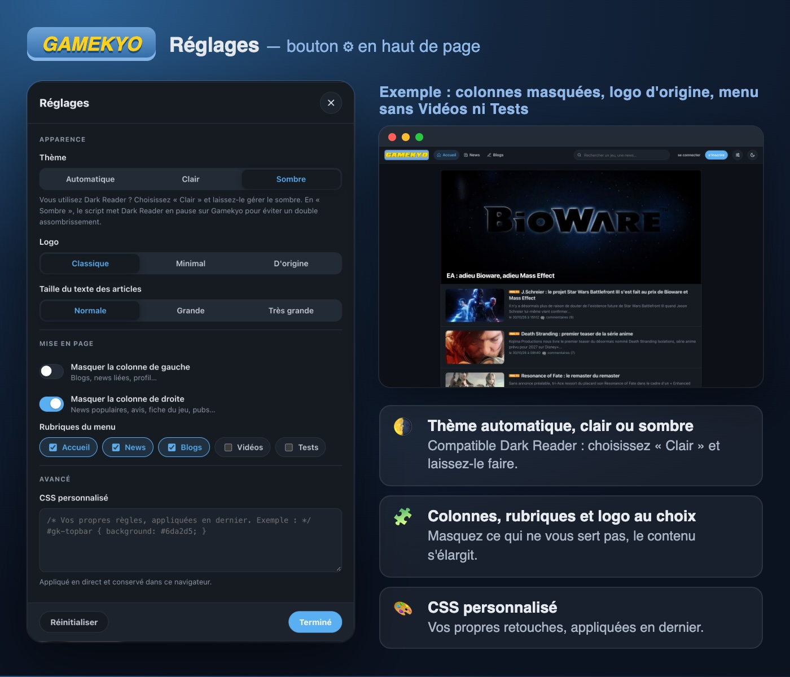

# Gamekyo Modern

**[Installer](https://raw.githubusercontent.com/maximehuran/tampermonkey-scripts/main/gamekyo/gamekyo-modern.user.js)** · [Changelog](CHANGELOG.md) · [Releases](https://github.com/maximehuran/tampermonkey-scripts/releases) · [Retour au dépôt](../README.md)

Modernise [gamekyo.com](https://www.gamekyo.com/) directement dans le navigateur, sans toucher à ses fonctionnalités. Les publicités ne sont pas bloquées, seulement contenues pour ne pas casser la mise en page.

## Fonctionnalités

### Apparence
- Design en cartes, typographie moderne, barre de navigation fixe avec recherche.
- **Mode sombre** : bouton soleil/lune, suit le thème du système par défaut, choix mémorisé.
- **Responsive** : 3, 2 puis 1 colonne selon la largeur, menu burger sur mobile (le script ajoute la balise viewport absente du site).
- Logo aux couleurs historiques (jaune sur bleu), avec variantes au choix dans les réglages.
- Images en meilleure résolution (vignettes d'origine au lieu des miniatures 80×60), chargement différé.

### Pages
- **Accueil** : diaporama avec titres, fil d'actus en cartes, tuiles « populaires » et « avis ».
- **Articles** (news, vidéos, blogs, avis) : texte lisible, temps de lecture, barre de progression, vidéos adaptées à la largeur, tags en pastilles, spoilers révélés au clic, « Qui a aimé ? » à côté du bouton like.
- **Commentaires et messages** : avatars ronds, bulles, formulaires modernisés.
- **Listes** (news, blogs, vidéos, tests) : notes en badges colorés (vert ≥ 8, orange ≥ 5, rouge en dessous).
- **Fiches jeu, profils, groupes, galeries** : cartes, grilles de vignettes.

### Mode connecté
- Menu compte dans la barre du haut : avatar, barre d'expérience, statut « défilante », liens vers ma page, profil, blog, amis, groupes, médias, messages, déconnexion.
- Raccourcis « Écrire un article » et « Messages ».
- Espace membre : menu d'administration, fils d'activité, gestion des amis et groupes, édition du profil (champs modifiables au clic), galeries, messagerie.

### Rédaction
- **Aperçu en direct** du BBCode : nouvel article, modification d'un article publié, commentaires, messages privés.
- Raccourcis clavier Ctrl/Cmd + B / I / U (gras, italique, souligné).
- Sélecteur de smileys dans l'éditeur d'article, compteur de caractères du titre, champ qui s'agrandit avec le texte.
- Survol lisible des zones modifiables sur place (titre, texte, source).

### Réglages
Bouton ⚙︎ dans la barre du haut (dans le menu burger sur mobile). Tout s'applique en direct et reste mémorisé dans le navigateur.

| Réglage | Choix |
| --- | --- |
| Thème | Automatique, Clair, Sombre |
| Logo | Classique (jaune/bleu), Minimal, D'origine (image du site) |
| Taille du texte des articles | Normale, Grande, Très grande |
| Colonne de gauche / de droite | Affichée ou masquée |
| Rubriques du menu | Accueil, News, Blogs, Vidéos, Tests : chacune peut être masquée |
| CSS personnalisé | Vos propres règles, appliquées après celles du script |

**Dark Reader** : choisissez le thème « Clair » pour laisser Dark Reader gérer le sombre. En thème « Sombre », le script ajoute la balise `darkreader-lock` pour que Dark Reader n'assombrisse pas une seconde fois.

## Limites connues

- Le script s'appuie sur la structure HTML de Gamekyo : si le site change, certaines pages peuvent mal s'afficher.
- L'aperçu BBCode est une reconstitution côté navigateur : le rendu final reste celui du serveur.
- Les réglages sont stockés dans le navigateur (`localStorage`) : ils ne suivent pas d'un appareil à l'autre.
